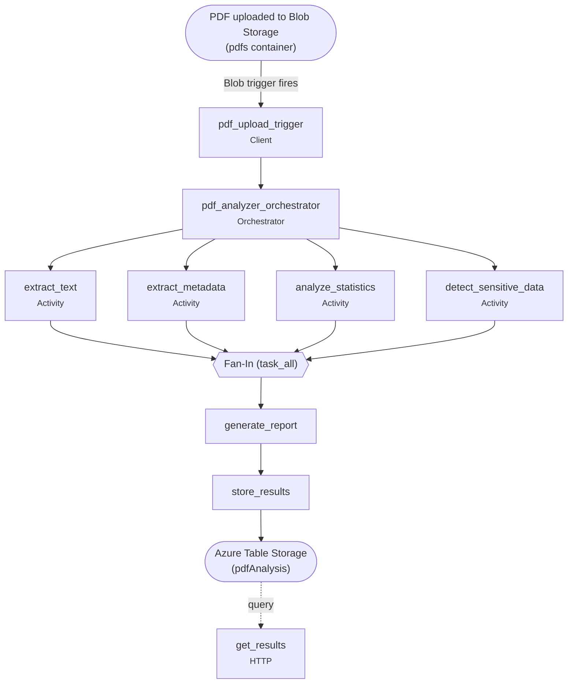

# Midterm Project — Smart PDF Analyzer with Durable Functions

**Course:** CST8917 — Serverless Applications | Spring/Summer 2026
**Project:** Smart PDF Analyzer (Fan-Out/Fan-In + Chaining)
**Demo video:** <!-- TODO: paste YouTube link --> `<youtube-link-here>`

---

## Team Members & Contribution Statement

| Member | Responsibilities / Contribution |
|--------|---------------------------------|
| Xinyi Zhao | Lab 2 base + extract_text and analyze_statistics |
| Sara Mirzaeipouynak | Lab 2 base + deployment + recording & peer review |
| Todd Oneil | Lab 2 base + orchestrator, blob_trigger, store and HTTP endpoint |
| Mimi Dib | Lab 2 base + report, bug fixes and detect_sensitive_data |

Note: Having done Lab 2 prior to submission, our group collectively did majority of the project each ourselves, and worked together on much of the outlying parts. 

---

## AI Disclosure

Used AI tools to scaffold the README, solidify learning concepts, python learning, and overall debugging. 
Any and all AI-generated code was reviewed, tested, and modified by the team.

---

## Overview

This project applies the **hybrid Durable Functions pattern** from Lab 2 to PDF documents.
When a PDF is uploaded to the `pdfs` Blob Storage container, a Durable Function triggers
automatically, runs **four analyses in parallel** (Fan-Out/Fan-In), combines them into a
single report (Chaining), stores the report in **Azure Table Storage**, and exposes the
results through an **HTTP endpoint**.

---

## Architecture Diagram



---

## Functions

| # | Function | Type | Role |
|---|----------|------|------|
| 1 | `pdf_upload_trigger` | Client | Detects PDF upload to `pdfs`, starts the orchestrator |
| 2 | `pdf_analyzer_orchestrator` | Orchestrator | Coordinates fan-out, fan-in, then the report→store chain |
| 3 | `extract_text` | Activity | Extracts text content from all pages |
| 4 | `extract_metadata` | Activity | Extracts PDF metadata (author, title, creation date, etc.) |
| 5 | `analyze_statistics` | Activity | Page count, word count, avg words/page, est. reading time |
| 6 | `detect_sensitive_data` | Activity | Scans for emails, phone numbers, URLs, and date patterns |
| 7 | `generate_report` | Activity | Combines all four analyses into a unified report |
| 8 | `store_results` | Activity | Saves the report to Azure Table Storage (`pdfAnalysis`) |
| 9 | `get_results` | HTTP | Retrieves stored analysis results from Table Storage |

All functions live in [`function_app.py`](function_app.py).

---

## Prerequisites

- **Python 3.11 or 3.12**
- **VS Code** with the **Azure Functions** extension
- **Azure Functions Core Tools** (`func` CLI)
- **Azurite** storage emulator
- **Azure Storage Explorer** (to create the `pdfs` container and upload test PDFs)
- An **Azure subscription** (for deployment)
- *Optional:* the **REST Client** VS Code extension (to run `test-function.http`)

### Dependencies (`requirements.txt`)

| Package | Purpose |
|---------|---------|
| `azure-functions` | Azure Functions SDK |
| `azure-functions-durable` | Durable Functions extension |
| `azure-data-tables` | Azure Table Storage SDK |
| `pymupdf` | PDF parsing (text + metadata extraction) |

---

## Run Locally

> All commands are run from the project folder.

### 1. Create the virtual environment and install dependencies

```bash
python -m venv .venv
# source .venv/bin/activate      # Linux/macOS
source .venv/Scripts/activate    # Windows (Git Bash)
python -m pip install -r requirements.txt
```

### 2. Create `local.settings.json`

Copy `local.settings.example.json` to `local.settings.json` and set the values:

```json
{
  "IsEncrypted": false,
  "Values": {
    "AzureWebJobsStorage": "UseDevelopmentStorage=true",
    "FUNCTIONS_WORKER_RUNTIME": "python",
    "PDF_UPLOAD_CONNECTION": "UseDevelopmentStorage=true"
  },
  "Host": { "CORS": "*" }
}
```

| Setting | Purpose |
|---------|---------|
| `AzureWebJobsStorage` | Durable Functions state storage |
| `PDF_UPLOAD_CONNECTION` | Connection used by the Blob trigger **and** Table Storage |
| `CORS` | Allows cross-origin requests to the function endpoints |

### 3. Start Azurite

- `F1` → **Azurite: Start** (or CLI: `azurite --silent --location .azurite`)

### 4. Create the `pdfs` container

The blob trigger watches a container literally named **`pdfs`** — create it before uploading
(via Azure Storage Explorer or the VS Code Azure extension → Local Emulator → Blob Containers).

### 5. Start the Function App

```bash
func start
```

### 6. Trigger the pipeline

Upload a `.pdf` into the **`pdfs`** container. The terminal will show the orchestration start,
the four parallel analyses, and the report being stored.

---

## Test the HTTP Endpoint

Use [`test-function.http`](test-function.http) (REST Client) or `curl`:

| Request | Description |
|---------|-------------|
| `GET /api/results` | Get all results |
| `GET /api/results/{id}` | Get a specific result by ID |

```bash
curl http://localhost:7071/api/results
```

---

## Deploy to Azure

### 1. Create the Function App

`F1` → **Azure Functions: Create Function App in Azure...(Advanced)**:

| Prompt | Selection |
|--------|-----------|
| Runtime stack | `Python 3.12` |
| OS | `Linux` |
| Hosting plan | `Consumption` **NOT flex- the code will not work**|
| Resource group | Create new, e.g. `rg-midterm-pdf` |
| Storage account | Create new |
| Application Insights | `Skip for now` |

### 2. Configure the application setting

Function App → **Settings → Environment variables** → **+ Add**:

| Name | Value |
|------|-------|
| `PDF_UPLOAD_CONNECTION` | The storage account's connection string |

### 3. Create the `pdfs` container

Storage Account → **Data Storage → Containers → + Container** → name it `pdfs`.

### 4. Deploy

`F1` → **Azure Functions: Deploy to Function App** → select your app → confirm.

### 5. Test in Azure

Upload a PDF to the `pdfs` container, then browse to
`https://<your-function-app-name>.azurewebsites.net/api/results`.

> The `pdfAnalysis` table is created automatically by the code on first run.


---

## Notes / Observations

- **Hosting plan — use Consumption, not Flex Consumption.** On the **Flex Consumption** plan
  the blob trigger defaults to an Event Grid–based source rather than the polling/log-scan
  source used by the classic **Consumption** plan, so the "upload a PDF to the `pdfs`
  container → orchestration starts automatically" flow did not fire. Deploying to the
  **Consumption** plan resolved this.
- **Consistent return shapes.** Each activity returns a dictionary with the **same keys** on
  both success and failure (failures return empty values rather than `None`), so
  `generate_report` always receives a predictable structure.
- **In-memory PDF handling.** Durable Functions serialize inputs as JSON, which cannot hold
  raw bytes, so the client passes the PDF as a list of integers (`list(blob_bytes)`). Each
  activity converts it back with `bytes(...)` and opens it from memory via
  `pymupdf.open(stream=..., filetype="pdf")` — no temporary file on disk.
- **Text extraction is per page.** `get_text()` is a method on a **page**, not the document,
  so the pages are looped and joined with `"".join(parts)` (faster than `+=` on a string,
  since strings are immutable).
- **Sensitive-data detection** uses Python's `re` module with regex patterns for emails,
  phone numbers, URLs, and dates.
